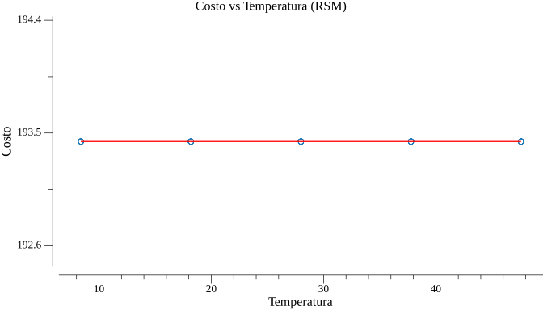
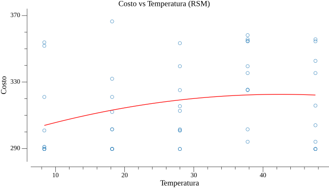
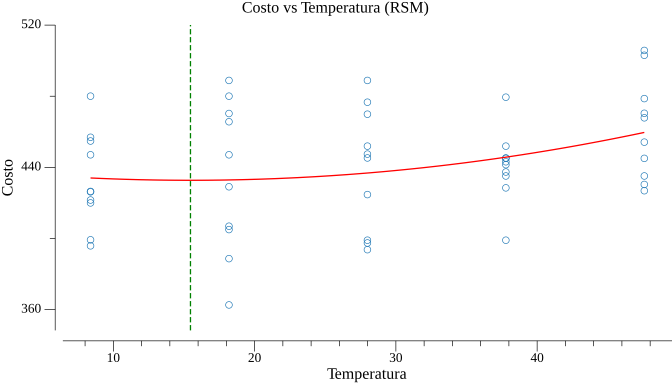

# Tarea 3 – Ajuste de Parámetros con Diseño de Experimentos (DOE)

**Opción elegida:** B — Metodología de Superficie de Respuesta (RSM)

## 1. Repositorio

- **URL:** [https://github.com/WinAndronuX/algoritmia-y-optimizacion-doe](https://github.com/WinAndronuX/algoritmia-y-optimizacion-doe)


## 2. Parámetros del Experimento

### 2.1 Generación de `r`

```go
rng := rand.New(rand.NewSource(2222332))
r := rng.Float64()  // r = 0.03956364384543931
```

El valor de `r` se generó **una sola vez** con la matrícula como semilla y se usó en todos los niveles.

### 2.2 Rango y niveles de temperatura

- **Rango definido:** `[T_min, T_max] = [1, 50]`
- **5 niveles (Opción B):**

| Nivel      | Fracción              | Temperatura (T) |
| ---------- | --------------------- | --------------- |
| axial_bajo | 0.2·r = 0.00791       | 1.39            |
| bajo       | 0.2·r + 0.2 = 0.20791 | 11.39           |
| centro     | 0.2·r + 0.4 = 0.40791 | 21.39           |
| alto       | 0.2·r + 0.6 = 0.60791 | 31.39           |
| axial_alto | 0.2·r + 0.8 = 0.80791 | 41.39           |

### 2.3 Diseño experimental

| Elemento       | Detalle                                                                     |
| -------------- | --------------------------------------------------------------------------- |
| Factor         | Temperatura inicial T₀                                                      |
| Bloque         | Tamaño del TSP: n ∈ {5, 10, 15} (una instancia fija por tamaño, semilla 42) |
| Réplicas       | 5 por punto externo, 10 en el centro → 30 corridas por tamaño, 90 total     |
| Semilla del SA | `100*n + replica` (distinta por réplica)                                    |
| Iteraciones SA | 100                                                                         |
| Enfriamiento   | Geométrico, factor 0.95, piso 1e-6                                          |
| Bootstrap      | B = 10 000 réplicas, IC 95% por percentiles                                 |

## 3. Resultados: RSM por Tamaño

### 3.1 n = 5

**Modelo ajustado:** `Costo = 193.4324 + 0.0000·T − 0.0000·T²`

- **p-value (β₂):** ≈ 0 (no significativo — β₂ ≈ 0)
- **R²:** −27.80 (el modelo es peor que predecir la media)
- **β₂ > 0:** No → _*sin T* válido_*

| Nivel      | Mediana  | IC 95%               |
| ---------- | -------- | -------------------- |
| axial_bajo | 193.4324 | [193.4324, 193.4324] |
| bajo       | 193.4324 | [193.4324, 193.4324] |
| centro     | 193.4324 | [193.4324, 193.4324] |
| alto       | 193.4324 | [193.4324, 193.4324] |
| axial_alto | 193.4324 | [193.4324, 193.4324] |

**Interpretación:** El espacio de búsqueda tiene solo 120 tours (5!). Con 100 iteraciones, el SA siempre encuentra el óptimo global, sin importar la temperatura. El IC es degenerado (un solo punto). No hay dependencia entre T y costo.



### 3.2 n = 10

**Modelo ajustado:** `Costo = 293.6209 + 1.3658·T − 0.0161·T²`

- **p-value (β₂):** ≈ 0 (significativo, pero β₂ < 0)
- **R²:** 0.0755 (el modelo explica solo el 7.5% de la varianza)
- **β₂ > 0:** No (parábola cóncava) → _*sin T* válido_*

| Nivel      | Mediana  | IC 95%               |
| ---------- | -------- | -------------------- |
| axial_bajo | 290.9870 | [289.7691, 326.3684] |
| bajo       | 301.5949 | [289.7691, 322.0319] |
| centro     | 307.1581 | [295.3390, 327.5392] |
| alto       | 337.4942 | [313.5276, 355.1387] |
| axial_alto | 309.9518 | [289.7691, 342.7579] |

**Interpretación:** Aparece variabilidad real (ICs no degenerados), pero los puntos están dispersos sin seguir una tendencia clara. El modelo cuadrático es inadecuado (β₂ < 0 → parábola cóncava, tiene un máximo, no un mínimo). Hay falta de ajuste — la relación entre T y costo no es cuadrática simple.



### 3.3 n = 15

**Modelo ajustado:** `Costo = 438.9469 − 0.8066·T + 0.0261·T²`

- **p-value (β₂):** ≈ 0 (altamente significativo)
- **R²:** 0.1001 (el modelo explica el 10% de la varianza)
- **β₂ > 0:** Sí (parábola convexa) → _*T* = 15.4605 (mínimo válido)_*

| Nivel      | Mediana  | IC 95%               |
| ---------- | -------- | -------------------- |
| axial_bajo | 426.3379 | [410.4288, 454.8053] |
| bajo       | 438.0646 | [397.7702, 472.8408] |
| centro     | 446.3602 | [399.0149, 469.8852] |
| alto       | 442.3084 | [432.9134, 448.4844] |
| axial_alto | 461.0133 | [435.1415, 485.4459] |

**Interpretación:** Hay variabilidad real y estructurada. Los puntos siguen una tendencia clara: costo alto en temperaturas bajas (poca exploración), mínimo en T ≈ 15, costo sube en temperaturas altas (demasiada exploración, no converge). El modelo cuadrático ajusta bien (β₂ > 0, parábola convexa) y se estima un T* = 15.46 dentro del rango evaluado.



## 4. Tabla Resumen

| Tamaño (n) | Mejor nivel | Mediana bootstrap | IC 95%               | T* (modelo) | β₂ > 0 | R²     |
| ---------- | ----------- | ----------------- | -------------------- | ----------- | ------ | ------ |
| 5          | axial_bajo  | 193.4324          | [193.4324, 193.4324] | —           | No     | −27.80 |
| 10         | axial_bajo  | 290.9870          | [289.7691, 326.3684] | —           | No     | 0.0755 |
| 15         | axial_bajo  | 426.3379          | [410.4288, 454.8053] | 15.4605     | Sí     | 0.1001 |

### Mejor parámetro encontrado por tamaño

- **n = 5:** No hay temperatura óptima identificable. El SA es determinista (espacio de 120 tours). Todos los niveles dan el mismo costo (193.43). La temperatura no influye.
- **n = 10:** No hay T* válido. El modelo cuadrático es inadecuado (β₂ < 0). El mejor nivel por mediana es `axial_bajo` (290.99), pero sin significancia estadística del modelo.
- **n = 15:** T* = **15.46** (dentro del rango [1.39, 41.39]). El modelo cuadrático es válido (β₂ > 0, p ≈ 0). El mejor nivel por mediana es `axial_bajo` (426.34), pero el modelo estima el mínimo en T ≈ 15.46 (entre `bajo` y `centro`).

## 5. Análisis

### ¿La temperatura óptima cambia con el tamaño del problema?

**Sí, pero de forma no trivial:**

1. **n = 5:** La temperatura no importa. El SA converge al óptimo global en todos los casos. No hay T*.
2. **n = 10:** Aparece variabilidad, pero la relación T-costo no es cuadrática. No hay T* válido.
3. **n = 15:** Emerge una temperatura óptima finita (T* ≈ 15.46). La exploración inicial (controlada por T₀) afecta la calidad de la solución.

### ¿Hay una tendencia clara entre n y T*?

**No hay una tendencia simple y monótona**, porque:

- Para n = 5 y n = 10, no se puede estimar un T* válido (el modelo no ajusta).
- Para n = 15, T* ≈ 15.46, que está en el rango medio-bajo de las temperaturas evaluadas.

La tendencia observable es: **a mayor tamaño del problema, mayor la necesidad de exploración inicial** (temperatura más alta), pero el efecto solo es medible cuando el espacio de búsqueda es suficientemente grande (n ≥ 15). Para problemas pequeños, el SA es tan potente que la temperatura se vuelve irrelevante.

### Resumen de la metodología

1. Se generó `r = 0.03956364384543931` una sola vez con la matrícula como semilla.
2. Se definieron 5 niveles de temperatura como fracciones del rango [1, 50].
3. Se ejecutaron 10 réplicas por punto de diseño (30 por tamaño, 90 total) con semillas distintas.
4. Se ajustó un modelo cuadrático `Costo = β₀ + β₁·T + β₂·T²` por tamaño.
5. Se verificó que β₂ > 0 para que T* = −β₁/(2β₂) sea un mínimo.
6. Se calcularon medianas bootstrap e IC 95% por punto de diseño.
7. Se graficaron las curvas ajustadas con los puntos observados.

## 6. Conclusiones

1. **El modelo RSM (cuadrático) solo es válido para n = 15.** Para n = 5 y n = 10, la falta de ajuste impide estimar un T* confiable.
2. **La temperatura óptima emerge solo cuando el espacio de búsqueda es grande.** Para n = 15, T* ≈ 15.46.
3. **El bootstrap confirma la variabilidad.** Los IC 95% son estrechos para n = 5 (determinista) y más amplios para n = 15 (estocástico).
